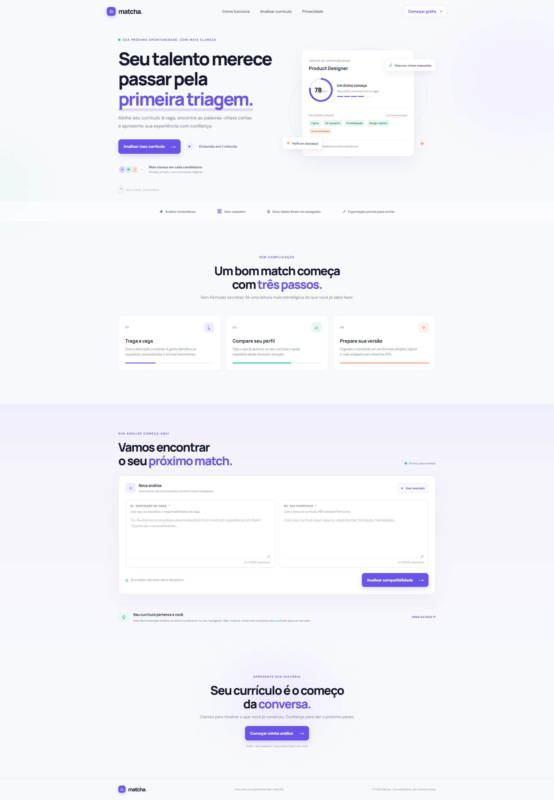

# Matcha

**Mais clareza para alinhar seu currículo à vaga que você deseja.**

Matcha é uma aplicação web estática que compara o texto de uma descrição de vaga com o currículo informado. Ela destaca palavras-chave encontradas e não localizadas, calcula uma estimativa de compatibilidade e organiza o currículo em um formato de texto simples para revisão e exportação.

## Prévia



## Sobre o projeto

O Matcha foi pensado para ajudar pessoas candidatas a identificar, com mais facilidade, como a experiência descrita no currículo se relaciona com os requisitos de uma vaga. A interface orienta a pessoa a revisar o próprio conteúdo e decidir o que faz sentido destacar — sem substituir sua avaliação nem alterar os fatos apresentados.

O projeto é uma demonstração front-end: não exige conta, API ou servidor de aplicação. A comparação é executada no navegador usando regras heurísticas em JavaScript.

## Funcionalidades

- Comparação entre a descrição da vaga e o currículo em texto.
- Identificação de termos reconhecidos como presentes ou ainda não localizados.
- Estimativa de compatibilidade apresentada em escala de 0 a 100.
- Organização do texto do currículo em seções simples, sem acrescentar informações.
- Cópia do currículo organizado para a área de transferência.
- Exportação por meio da janela de impressão do navegador, com opção de salvar em PDF.
- Exemplo preenchido para experimentar a análise.
- Contador de caracteres e limite de 12.000 caracteres para cada campo.
- Layout responsivo, navegação adaptada para dispositivos móveis e suporte à preferência por movimento reduzido.

## Como usar

1. Abra a aplicação no navegador.
2. Cole a descrição da vaga e o texto do currículo nos campos correspondentes. A descrição precisa ter ao menos 40 caracteres e o currículo, 35.
3. Selecione **Analisar compatibilidade** para visualizar a estimativa e as palavras-chave.
4. Revise os termos encontrados e os que ainda não foram localizados. Considere incluir algo no currículo somente se representar sua experiência real.
5. Confira o currículo organizado e use **Copiar texto** ou **Exportar PDF**. Na janela de impressão, escolha **Salvar como PDF**, se desejar.

Também é possível selecionar **Usar exemplo** para preencher os campos com dados demonstrativos.

## Como a análise funciona

1. O texto da vaga é normalizado para reduzir diferenças de maiúsculas e acentuação.
2. O Matcha procura competências de um vocabulário interno, incluindo algumas variações e sinônimos, e também identifica determinadas expressões repetidas na descrição.
3. Os termos encontrados na descrição são comparados com o texto do currículo. A interface separa os termos localizados daqueles que não encontrou.
4. A estimativa combina a proporção de palavras-chave localizadas (peso de 86%) com o volume de palavras consideradas no currículo (peso de até 14%). O resultado é limitado ao intervalo de 8 a 98.
5. O currículo é reorganizado preservando as linhas informadas e destacando alguns títulos de seção reconhecidos. O conteúdo não é gerado nem reescrito.

Essa lógica não interpreta contexto como uma pessoa ou um sistema de recrutamento. Ela pode deixar de reconhecer sinônimos, variações de escrita e competências relevantes, ou sinalizar termos sem compreender seu significado. Por isso, a nota e a lista de palavras-chave devem ser usadas apenas como apoio à revisão.

## Tecnologias

- HTML5
- CSS3
- JavaScript sem framework
- Fontes DM Sans e Manrope, carregadas do Google Fonts

Não há dependências de aplicação para instalar ou etapa de compilação.

## Executar localmente

Não é necessário instalar pacotes ou configurar variáveis de ambiente.

1. Baixe ou clone os arquivos do projeto.
2. Abra `index.html` diretamente no navegador.
3. Para desenvolvimento, sirva a pasta com qualquer servidor HTTP estático local.

## Estrutura do projeto

```text
.
├── index.html       # Estrutura da página e da interface
├── style.css        # Estilos, layout responsivo e animações
├── script.js        # Análise, interação e exportação
├── img/
│   └── print.png    # Captura da aplicação exibida neste README
└── README.md        # Documentação do projeto
```

## Privacidade

Os textos da vaga e do currículo são processados localmente no navegador. A aplicação não os envia para um servidor nem os salva em `localStorage`. O navegador ainda pode fazer uma solicitação ao Google Fonts para carregar as fontes visuais; essa solicitação não inclui os textos inseridos no Matcha.

Como o conteúdo pode conter dados pessoais, evite usar informações reais em computadores compartilhados e revise os dados de contato antes de exportar ou enviar o currículo.

## Limitações

- A entrada é feita por texto colado; o projeto não importa nem extrai conteúdo de arquivos PDF.
- A análise usa um vocabulário e regras definidos no código, não inteligência artificial nem integração com plataformas ATS.
- A compatibilidade não mede a qualidade geral do currículo nem garante que um requisito seja atendido na prática.
- A organização preserva o texto fornecido e não cria uma versão personalizada automaticamente.
